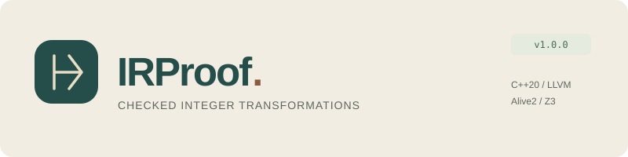
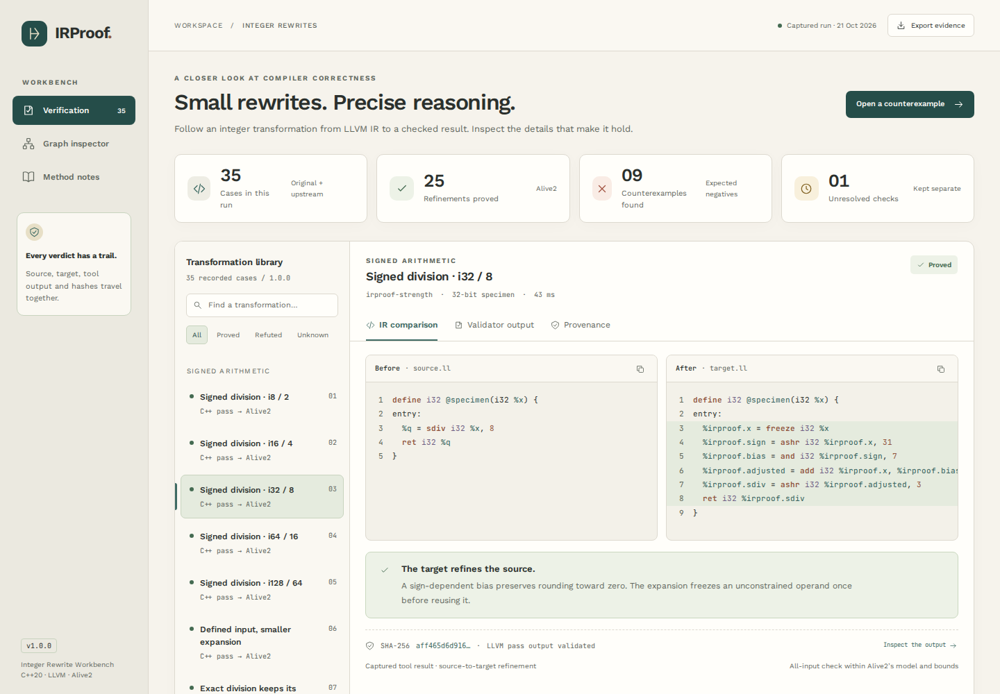

<p align="center"></p>

<p align="center"><a href="https://sarvenaz-m.github.io/IRProof/"></a></p>

<p align="center"><strong>C++20 · LLVM 23 · Alive2</strong></p>

IRProof is a small compiler engineering workbench for a question that is easy to underestimate: when does a familiar integer rewrite preserve LLVM semantics?

The C++20 pass rewrites scalar power-of-two operations, then a local runner sends the actual source and target to Alive2. The workbench brings the IR, validator output and provenance into one view. A separate C++ frontend emits structured examples with branches, PHI nodes and a loop.

The compiler implementation uses C++20. Python runs the validation pipeline, and JavaScript powers the browser workbench.

**[Open the live demo](https://sarvenaz-m.github.io/IRProof/)** to explore the rewrites and their captured evidence. For offline use, open `index.html`, `demo/index.html` or `demo/IRProof.html` from this package in a browser. Each entry point carries the same interface, fonts and validation records. The browser displays completed checks; compiler and solver runs take place locally.

<p align="center"><a href="https://sarvenaz-m.github.io/IRProof/"></a></p>

## Captured results

Verified on 21 October 2026 with LLVM **23.1.4**, pinned Alive2 revision **c9af7dbb5038** plus the included compatibility patch, and Z3 **5.3.1**.

| Check | Result |
| --- | ---: |
| Source-to-target pairs | 35 |
| Refinements proved | 25 |
| Deliberately invalid rewrites refuted | 9 |
| Unsupported atomic-memory check | 1 unknown |
| Tool errors / unexecuted checks | 0 / 0 |
| Concrete comparisons executed with `lli` | 1,690 |
| Verdict-parser unit tests | 12 passed |

The negative cases are useful results: they catch rounding errors, invented flags, unsafe sign-bit multiplication and mishandled undefined values. The atomic case stays unknown. Neither an exit code of zero nor a missing counterexample is treated as a proof.

The test suite also covers source preparation inside a Git checkout, cached-source verification and the standalone demo entry points.

## A representative rewrite

```llvm
; Before
%q = sdiv i32 %x, 8

; After, for an operand not known to be defined
%stable = freeze i32 %x
%sign = ashr i32 %stable, 31
%bias = and i32 %sign, 7
%adjusted = add i32 %stable, %bias
%q = ashr i32 %adjusted, 3
```

For a negative input, the bias preserves rounding toward zero. A plain arithmetic shift rounds down: `-3 / 2` is `-1`, while `-3 >> 1` is `-2`. Known nonnegative values use a shorter logical shift. Exact division and existing overflow flags have their own paths.

The pass also handles positive power-of-two multiplication, unsigned division, unsigned remainder and selected neutral operations. It leaves the control-flow graph intact. It deliberately skips a signed-negative sign-bit multiplier, where `mul nsw` and `shl nsw` have different defined domains.

## Project layout

| Area | Responsibility |
| --- | --- |
| `src/`, `include/` | New Pass Manager plugin and a read-only IR audit |
| `tools/irproof-gen.cpp` | LLVM IRBuilder examples with structured control flow |
| `corpus/` | Original cases, generated IR and four pinned public Alive2 regressions |
| `scripts/` | Validator execution, evidence checks, frontend capture and demo export |
| `tests/` | Verdict handling, compiled-pass checks and browser smoke checks |
| `evidence/` | Actual tool output, checked IR, analysis JSON and validation records |
| `demo/` | Responsive evidence viewer, graphs and a concrete integer lab |
| `patches/` | The recorded Alive2 compatibility change for LLVM 23 |
| `docs/` | Architecture notes, reproducible commands and the technical report |

## Reproduce locally

The compiled components require LLVM 23 development files, CMake 3.24+, Ninja and a C++20 compiler. The scripts use Python 3.10+; the validator bootstrap additionally needs Git, re2c and pip. Keep `opt`, `llvm-extract`, `lli` and the development headers from the same LLVM installation.

```sh
cmake -S . -B build -G Ninja -DCMAKE_BUILD_TYPE=Release \
  -DLLVM_DIR="$(llvm-config --cmakedir)"
cmake --build build --parallel 2
ctest --test-dir build --output-on-failure
```

Use an existing matching `alive-tv`, or build the pinned source with `scripts/bootstrap_alive2.py`. The full sequence is in [Reproducibility](docs/reproducibility.md). The captured file chain can be checked without a compiler:

```sh
python scripts/verify_evidence.py
```

## Scope and interpretation

This release implements a focused pass and an inspection workflow. It is not a general-purpose compiler, a new verification algorithm or a claim of a hardware speedup. Signed lowering can increase the IR instruction count. The source-to-target results cover the captured functions within Alive2's supported model and bounds; they do not prove every future use of the pass correct.

The loop specimen demonstrates IR construction and analysis. It is not included in the claimed refinement count. The arithmetic lab uses browser BigInt for concrete values and does not model LLVM memory, poison or undef. Read [Architecture](docs/architecture.md) and the [technical report](docs/IRProof-Technical-Report.pdf) for the design and its limits.

## Sources and licensing

The four upstream files are copied unchanged from the Alive2 regression corpus under its MIT license. Their paths, checksums and exact revision are in `corpus/upstream/provenance.json`. Fonts are included under SIL OFL 1.1. Original project code is MIT-licensed; [third-party notices](third_party/NOTICE.md) identify the external components.

Primary references: [LLVM Language Reference](https://llvm.org/docs/LangRef.html), [New Pass Manager development](https://llvm.org/docs/WritingAnLLVMNewPMPass.html), [Alive2](https://github.com/AliveToolkit/alive2), and [Lopes et al., PLDI 2021](https://doi.org/10.1145/3453483.3454030).
